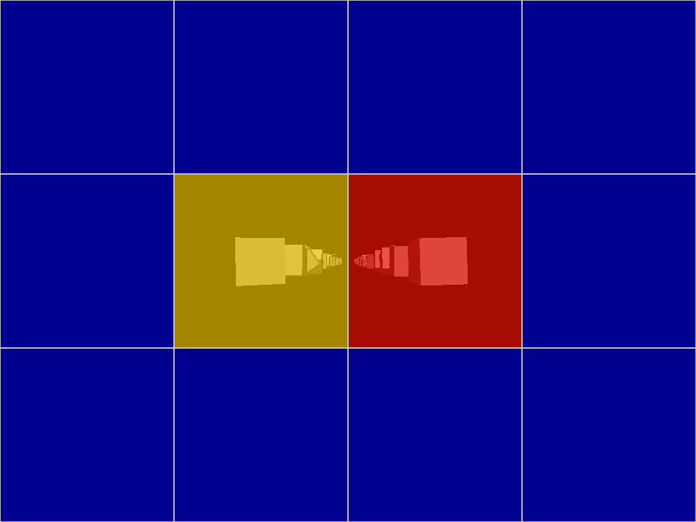
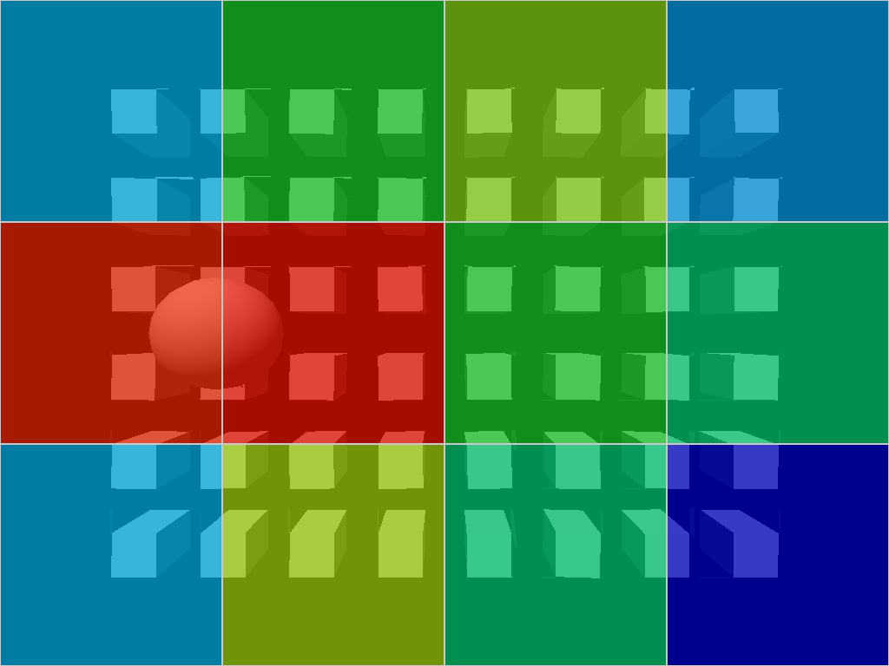
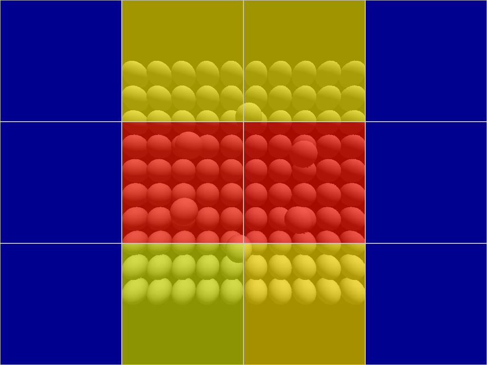

# RenderScope — CPU Rendering Performance Analyzer

[](https://en.cppreference.com/w/cpp/20)
[](https://en.wikipedia.org/wiki/Advanced_Vector_Extensions)
[](https://opensource.org/licenses/MIT)
[]()

**RenderScope** is a high-performance software rasterizer, CPU microarchitectural benchmarking suite, and rendering performance profiler engineered by **Sneh Kansagara**.

It provides an end-to-end framework to analyze CPU software rendering performance across instruction sets (Scalar vs. AVX2 SIMD), concurrency scaling (1 to 16+ worker threads), spatial tile partitioning, and geometric complexity. RenderScope includes a built-in visual heatmap profiler, an automated correctness verification engine, and automated Python analytics with publication-quality performance graphs.

---

## Architecture Overview

```
                      +-----------------------------+
                      |       3D Scene Data         |
                      | (Meshes, Vertices, Indices) |
                      +--------------+--------------+
                                     |
                                     v
                      +-----------------------------+
                      |   Vertex Transform Cache    |
                      |  Matrix * Vector (SSE4.1)   |
                      +--------------+--------------+
                                     |
                                     v
                      +-----------------------------+
                      |   2D Screen Tile Binning    |
                      |  (Triangles -> 256x256 Tiles)|
                      +--------------+--------------+
                                     |
                                     v
                      +-----------------------------+
                      |  Thread Pool Job Dispatch   |
                      |  (Disjoint Screen Tiles)    |
                      +--------------+--------------+
                                     |
                   +-----------------+-----------------+
                   |                                   |
                   v                                   v
        +---------------------+             +---------------------+
        |  Scalar Rasterizer  |             |  AVX2 8-Wide SIMD   |
        | Pixel-by-pixel math |             | 8 Pixels / Vector   |
        +----------+----------+             +----------+----------+
                   |                                   |
                   +-----------------+-----------------+
                                     |
                                     v
                      +-----------------------------+
                      |  Per-Tile Time Profiler     |
                      |    (Microsecond Timers)     |
                      +--------------+--------------+
                                     |
                                     v
                      +-----------------------------+
                      |    Thermal Heatmap Overlay  |
                      |  Blue -> Green -> Red Blend |
                      +--------------+--------------+
                                     |
                                     v
                      +-----------------------------+
                      |  Framebuffer / Image Export |
                      |    (BMP / PPM / Display)    |
                      +-----------------------------+
```

### Key Architectural Pillars

1. **Matrix & Vector SIMD (SSE4.1):** 4x4 matrix-vector transformations utilize SSE4.1 dot products (`_mm_dp_ps`) and aligned memory operations. 4D vectors (`vec4`) are strictly 16-byte aligned.
2. **Vertex Transform Cache:** Every vertex in a mesh is transformed into screen space exactly once per frame and cached. Subsequent triangles referencing shared vertices avoid redundant geometric transformations.
3. **Tile-Based Concurrency:** The screen is partitioned into disjoint 2D tiles (e.g. 256x256 pixels). Triangles are binned into overlapping tiles, allowing worker threads to render in parallel without per-pixel locking or race conditions.
4. **AVX2 8-Wide Triangle Rasterization:** Triangle bounding boxes are evaluated in horizontal packets of 8 pixels (`__m256`). Edge equations, barycentric coordinates, depth interpolation, Z-buffering, and Blinn-Phong diffuse lighting are executed simultaneously across 8 pixels.
5. **Tile Execution Profiling & Thermal Heatmap:** The rendering engine instruments per-tile execution latency with microsecond precision. A 5-stop thermal gradient maps compute density across the viewport, visually isolating rendering hotspots. Zero profiling overhead is incurred when disabled.

---

## Features

- **Multi-Instruction Pipeline:** Toggle dynamically between pure Scalar rendering and AVX2 8-wide vectorized execution.
- **Scalable Concurrency:** Benchmark from 1 thread up to the host machine's maximum thread capacity (1 to 16+ threads).
- **Execution Heatmap Overlay:** Real-time visual overlay highlighting expensive viewport regions (Blue = fast, Red = heavy compute).
- **Correctness Verification Suite:** Bit-exact and subpixel framebuffer comparison between Scalar, SIMD, and multi-threaded outputs.
- **Automated Benchmark Runner:** Multi-iteration benchmark suite testing multiple scenes and resolutions with direct CSV export.
- **Automated Analysis Toolkit:** Python analysis tool (`scripts/analyze_benchmarks.py`) generating publication-grade comparison plots and systems analysis.
- **Cross-Platform:** Native compilation on Linux (GCC/Clang via CMake or Makefile) and Windows (MSVC via Visual Studio).

---

## Benchmark & Profiling Visualizations

### 1. Performance Heatmap
RenderScope visually highlights spatial workload distribution. Tiles with dense geometric overlaps and high depth complexity appear in bright yellow/red, while background and empty regions appear in dark blue.

| Scene 1 Heatmap | Scene 2 Heatmap | Scene 3 Heatmap |
|:---:|:---:|:---:|
|  |  |  |
| *40 Dynamic Cubes* | *48 Cube Grid + Sphere* | *106 Spheres (Dense Geometry)* |

### 2. Multi-Core Scaling & SIMD Comparison

| Execution Time Across Configurations | Speedup vs Scalar Baseline |
|:---:|:---:|
|  |  |

| Multi-Thread Scaling Curves | AVX2 SIMD Speedup Factor |
|:---:|:---:|
|  |  |

---

## Build Instructions

### Prerequisites
- **Linux:** GCC 11+ or Clang 14+ (supporting C++20), CMake 3.16+, GNU Make, Python 3.8+ with Matplotlib.
- **Windows:** Visual Studio 2022 (v143 toolset) with C++20 enabled.

### Building on Linux (CMake)
```bash
# Configure and build in Release mode
cmake -B build -DCMAKE_BUILD_TYPE=Release
cmake --build build -j$(nproc)

# Binary is generated at ./build/renderscope
```

### Building on Linux (GNU Make)
```bash
# Build optimized binary
make

# Binary is generated at ./renderscope
```

### Building on Windows (Visual Studio)
1. Open `Rasterizer.sln` in Visual Studio 2022.
2. Select **Release** configuration and **x64** platform.
3. Build Solution (`Ctrl + Shift + B`).

---

## Usage & CLI Reference

### 1. Correctness Verification
Verifies mathematical and visual equivalence between Scalar and AVX2 SIMD, and between single-threaded and multi-threaded rendering:
```bash
./renderscope --verify
```

### 2. Performance Profiling & Heatmap Export
Instruments rendering stages and saves a thermal heatmap image (`.bmp` or `.ppm`):
```bash
# Generate heatmap for Scene 1
./renderscope --scene 1 --heatmap --save heatmap_scene1.bmp

# Generate heatmap for Scene 3 at 1024x768
./renderscope --scene 3 --resolution 1024x768 --heatmap --save heatmap_scene3.bmp
```

### 3. Comprehensive CPU Benchmark Suite
Runs multi-iteration benchmarks across scene geometries, resolutions, thread counts, and SIMD modes:
```bash
# Run complete benchmark suite and export to CSV
./renderscope --benchmark \
  --scene all \
  --resolution 640x480,1024x768 \
  --threads 1,2,4,8,16 \
  --simd both \
  --iterations 5 \
  --csv benchmark_results.csv
```

### 4. Automated Python Analysis & Charting
Parses benchmark CSV files, highlights fastest configurations, and outputs publication-quality charts:
```bash
python3 scripts/analyze_benchmarks.py \
  --csv benchmark_results.csv \
  --output-dir docs/charts \
  --report docs/benchmark_analysis_report.md
```

### 5. Interactive Mode
Runs the real-time continuous rendering loop:
```bash
./renderscope --interactive --scene 1
# Controls: Press 'H' to toggle heatmap overlay in real-time, ESC to exit.
```

---

## Metrics & Statistical Calculations

RenderScope captures high-precision timestamps using `std::chrono::high_resolution_clock` and computes:

| Metric | Calculation / Formula | Description |
|:---|:---|:---|
| **Mean Frame Time** | $\bar{T} = \frac{1}{N} \sum_{i=1}^N T_i$ | Average frame execution latency across $N$ iterations. |
| **Median Latency** | $\text{Median}(T_1, \dots, T_N)$ | 50th percentile latency, resilient against OS scheduling spikes. |
| **Min / Max Latency** | $\min(T_i), \max(T_i)$ | Extreme bounds of frame execution time. |
| **Frames Per Second (FPS)** | $\text{FPS} = \frac{1000}{\bar{T}_{\text{ms}}}$ | Sustained rendering throughput. |
| **Speedup Factor** | $S = \frac{\bar{T}_{\text{baseline}}}{\bar{T}_{\text{optimized}}}$ | Relative performance gain compared to Single-Threaded Scalar baseline. |
| **Parallel Efficiency** | $E = \frac{S}{P}$ | Multi-core scaling efficiency normalized by thread count $P$. |

---

## Systems Engineering Analysis

Real benchmark measurements on AMD Ryzen 9 270 (16 threads) highlight critical hardware realities:

1. **Concurrency Overhead vs. Workload Size:**
   - In lightweight workloads (Scene 1 @ 640x480, frame time `~0.16 ms`), launching multiple threads introduces thread pool synchronization and wake-up overhead that exceeds the computation time of the individual tiles, resulting in performance regression (`0.69x` speedup).
   - In heavier pixel workloads (Scene 2 @ 1024x768, frame time `~3.63 ms`), multithreading amortizes scheduling overhead, achieving a strong **3.73x speedup**.
2. **Amdahl's Law Bottleneck in Geometry-Heavy Scenes:**
   - In Scene 3 (106 spheres), profiling reveals that **59.3% of execution time is spent in vertex transformation and caching**. Because vertex transformation is executed prior to tile dispatch, parallelizing only the rasterization stage limits the theoretical maximum speedup to `~2.2x`, matching empirical results.
3. **SIMD Compute vs. Memory Bandwidth Saturation:**
   - At 1 thread, AVX2 SIMD achieves **1.4x to 2.2x speedup** over scalar rasterization.
   - At 16 threads, all cores concurrently stream writes to the backbuffer and Z-buffer, shifting the bottleneck from vector compute to L3 cache and memory bus bandwidth.

---

## Project Maintainer & Contributions

**Sneh Kansagara**
- Engineered the RenderScope CPU performance analysis framework.
- Designed and implemented the tile execution profiler and thermal heatmap overlay.
- Developed the configurable Scalar vs. AVX2 SIMD rasterization test harness.
- Built the automated benchmarking engine, statistical aggregation, and CSV exporter.
- Implemented the automated Python analytical reporting tool and chart generators.
- Added cross-platform Linux compatibility (CMake, GNU Make, zero-dependency software canvas).
- Authored the comprehensive documentation and systems performance evaluation.

---

## Third-Party Credits & Licensing

- **GamesEngineeringBase:** The windowing and timer platform interface is derived from the MSc Games Engineering Team base header (`GamesEngineeringBase.h`), provided under the [MIT License](https://opensource.org/licenses/MIT):
  ```
  Copyright (c) 2024-2025 MSc Games Engineering Team
  ```
- **RenderScope:** Licensed under the MIT License.

---

## Future Roadmap

- [ ] **AVX-512 Vector Path:** Add 16-wide packet rasterization for modern CPUs supporting AVX-512.
- [ ] **Parallel Vertex Transformation:** Parallelize the vertex transformation and caching phase across threads to eliminate Amdahl's Law bottlenecks in geometry-dense scenes.
- [ ] **Dynamic Work Stealing:** Replace static tile assignment with a lock-free work-stealing queue to resolve spatial load imbalance in clustered scenes.
- [ ] **Hierarchical Z-Buffering (HZB):** Implement tile-level min/max depth bounds for early tile rejection before pixel evaluation.
